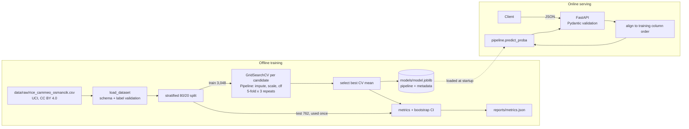

# Rice Variety Classifier


## Project Overview

Classifies a rice grain as **Cammeo** or **Osmancik** from seven shape measurements extracted
from a grain image, using the public UCI *Rice (Cammeo and Osmancik)* dataset (3,810 grains).
The focus is on an evaluation protocol you can trust and a model you can deploy: every
preprocessing step lives inside one scikit-learn pipeline, six candidates are compared with
repeated cross-validation on the training split only, the test split is touched once, and the
selected model is served by a validated FastAPI service in a slim Docker image.

**Key results**

- **Logistic regression is selected** (CV 0.9339 ± 0.0111) and scores **0.9199** on the 762-grain
  test split, 95 % bootstrap CI **[0.900, 0.938]**, ROC AUC 0.9755.
- **The five non-trivial models are statistically indistinguishable.** Their CV means span
  0.929–0.934, well inside one CV standard deviation (≈ 0.011), and all their test-accuracy
  confidence intervals overlap. A linear model is therefore the right choice: the cheapest,
  most interpretable and best-calibrated option (Brier 0.061).
- **A leakage audit finds no measurable effect here.** Fitting the scaler on all rows before
  cross-validation changes CV accuracy by 0.00 pp for every model: with no missing values and
  ~3,000 training rows, the scaling statistics barely move between folds. The audit is kept as a
  reusable check (`rice leakage-audit`), and the pipeline design rules the leak out by construction.

## Key Features

| Feature | Verified result |
|---|---|
| One pipeline from raw features to prediction (median imputer → standard scaler → classifier) | The same artifact is used for evaluation and serving; a row predicted alone or in a batch gives the same result (tested) |
| Selection on the training split only | 6 candidates × grid search × 5-fold CV repeated 3 times (15 folds); the test split never influences selection (tested) |
| Uncertainty, not just point scores | CV mean ± std for every candidate; 2,000-resample bootstrap 95 % CI for test accuracy |
| Leakage audit | Same folds, preprocessing fit inside vs. outside CV: < 0.01 pp difference on this dataset |
| Validated REST API | `/predict` p50 **2.2 ms** over HTTP; 1,000-row batch in **3.1 ms** (≈ 320 k rows/s); 422 on invalid input, 413 on oversized batches, 503 without a model |
| Tested and linted | **97 tests**, **99 % branch coverage**, Ruff clean (pycodestyle, pyflakes, isort, pydocstyle, bugbear, …) |
| Slim, non-root container | Two-stage build, `app` user, Python healthcheck, **475 MB** (111 MB compressed); compose trains first and starts the API only if training succeeds |

## System Architecture



| Step | Component | Fit on | Notes |
|---|---|---|---|
| Missing values | `SimpleImputer(strategy="median")` | training rows of each fold | The dataset has none, but the API accepts `null` and imputes it with the training median |
| Scaling | `StandardScaler` | training rows of each fold | Needed by logistic regression, KNN and the SVM; harmless for trees |
| Labels | `{"Cammeo": 0, "Osmancik": 1}` | — | Unknown labels raise `DataValidationError` |
| Column alignment | `predict_records` | — | Requests are re-ordered to the training column order, so feature width and order always match |

## Tech Stack

| Layer | Tools |
|---|---|
| Modelling | scikit-learn 1.9.1, pandas 3.1, NumPy 2.5 |
| Configuration | pydantic-settings (`RICE_*` environment variables / `.env`), TOML grids |
| Serving | FastAPI 0.162, Uvicorn, Pydantic v2 |
| CLI | Typer |
| Quality | pytest, pytest-cov, Ruff, type hints, Google-style docstrings |
| Deployment | Docker multi-stage build, docker compose |

## Quick Start

### Local

```bash
git clone https://github.com/daniel880830/rice-variety-classifier.git
cd rice-variety-classifier
python -m venv .venv && source .venv/bin/activate   # Windows: .venv\Scripts\activate
pip install -r requirements-dev.txt && pip install -e . --no-deps
cp .env.example .env                                 # optional: port, paths, batch limit

rice train            # grid search, test metrics, saves the CV-selected model
rice leakage-audit    # preprocessing fit inside vs. outside the folds
rice serve            # http://127.0.0.1:8000 redirects to /docs
```

```bash
curl -X POST http://127.0.0.1:8000/predict -H "Content-Type: application/json" -d '{
  "area": 15231, "perimeter": 525.58, "major_axis_length": 229.75, "minor_axis_length": 85.09,
  "eccentricity": 0.9289, "convex_area": 15617, "extent": 0.5729}'
# {"label":0,"class_name":"Cammeo","probability":0.99995...}
```

`POST /predict/batch` takes `{"items": [ ... ]}` (at most `RICE_MAX_BATCH_SIZE`, default 1000).
`GET /health` and `GET /model/info` report readiness and training metadata.

### Docker

```bash
docker compose up --build   # trains, then starts the API only if training succeeded
```

`./data/raw` is mounted read-only into the training container. The published host port is
`RICE_HOST_PORT` (default `8000`); set it in `.env` if 8000 is taken.

## Evaluation & Benchmarks

Split: stratified 80/20 (3,048 / 762 grains), `random_state=42`. Model selection: grid search with
stratified 5-fold CV repeated 3 times on the training split. All numbers come from
[`reports/metrics.json`](reports/metrics.json) and [`reports/leakage_audit.json`](reports/leakage_audit.json).

### Model comparison

| Model | Best parameters | CV accuracy (15 folds) | Test accuracy [95 % CI] | Macro F1 | Cohen κ | ROC AUC | Brier ↓ |
|---|---|---|---|---|---|---|---|
| Majority class (baseline) | — | 0.5722 ± 0.0005 | 0.5722 [0.537, 0.605] | 0.3639 | 0.000 | 0.500 | 0.428 |
| **Logistic regression** (selected) | C = 10 | **0.9339 ± 0.0111** | **0.9199** [0.900, 0.938] | 0.9178 | 0.836 | **0.976** | **0.061** |
| SVM, RBF kernel (calibrated) | C = 10, γ = scale | 0.9324 ± 0.0107 | 0.9121 [0.891, 0.931] | 0.9096 | 0.819 | 0.954 | 0.068 |
| Random forest | 300 trees, depth 4, min leaf 20 | 0.9300 ± 0.0114 | 0.9160 [0.895, 0.934] | 0.9136 | 0.827 | 0.973 | 0.063 |
| k-nearest neighbours | k = 41, uniform | 0.9299 ± 0.0110 | 0.9134 [0.894, 0.932] | 0.9111 | 0.822 | 0.971 | 0.065 |
| HistGradientBoosting | lr 0.03, 7 leaves | 0.9290 ± 0.0103 | 0.9147 [0.894, 0.933] | 0.9123 | 0.825 | 0.973 | 0.063 |

Confusion matrix of the selected model on the test split (rows = true, columns = predicted):

| | Cammeo | Osmancik |
|---|---|---|
| **Cammeo** (326) | 289 | 37 |
| **Osmancik** (436) | 24 | 412 |

Most errors are Cammeo grains predicted as Osmancik (37 of 326, 11 %), against 24 of 436 (6 %)
the other way round.

### Leakage audit

| Model | CV accuracy, preprocessing inside folds | Preprocessing fit on all training rows | Gap |
|---|---|---|---|
| Logistic regression | 0.9337 | 0.9337 | 0.00 pp |
| SVM (RBF) | 0.9324 | 0.9324 | 0.00 pp |
| k-NN | 0.9308 | 0.9308 | 0.00 pp |
| Random forest | 0.9301 | 0.9301 | 0.00 pp |
| HistGradientBoosting | 0.9281 | 0.9281 | 0.00 pp |

A null result, reported as such: this kind of leak matters when there are many missing values,
few rows or target-dependent preprocessing, none of which apply here. The audit runs on 5 folds,
so its numbers differ slightly from the 15-fold selection table.

### Inference performance

| Metric | Value |
|---|---|
| In-process single row (`predict_records`, 500 calls) | p50 0.86 ms · p95 0.94 ms |
| In-process batch of 1,000 rows | 3.1 ms (≈ 322,000 rows/s) |
| HTTP `POST /predict`, sequential, 300 calls | p50 2.16 ms · p95 23.84 ms · 122 req/s |
| Model artifact | 2.9 KiB |
| Docker image | 475 MB on disk · 111 MB compressed |

Measured with `rice benchmark --url …` on an AMD Ryzen 7 7800X3D, 64 GB RAM, Windows 11,
Python 3.13.5, scikit-learn 1.9.1, one Uvicorn worker ([`reports/benchmark.json`](reports/benchmark.json)).

### Reproducibility

Training in the Linux container and on Windows gives identical results for every metric; the
only difference is the 16th decimal of one Brier score (≈ 2 × 10⁻¹⁶).

## Project Background

I built this as an independent portfolio project on a public dataset, after working on a
similar classification exercise in a team setting. The goal was to practise the parts that
small ML projects usually skip: a selection protocol that keeps the test set honest,
uncertainty estimates, a leakage check, and a tested, containerised inference service.

## Data and License

Code: [MIT](LICENSE). The dataset is © Cinar & Koklu (2019), distributed under CC BY 4.0
(not covered by the MIT license); see [`data/README.md`](data/README.md) for the source,
citation and checksum.

## Project Structure

```
rice-variety-classifier/
├── config/params.toml           # split, CV, bootstrap and the grid for each candidate
├── data/
│   ├── README.md                # source, license, citation, checksum
│   └── raw/rice_cammeo_osmancik.csv
├── models/                      # model.joblib (git-ignored)
├── reports/                     # metrics.json, leakage_audit.json, benchmark.json
├── src/rice_classifier/
│   ├── config.py   schema.py    data.py      features.py   models.py
│   ├── train.py    evaluate.py  predict.py   benchmark.py
│   └── api.py      cli.py
├── tests/
│   ├── unit/                    # config, data validation, preprocessing, models, training, schema
│   └── integration/             # API (TestClient), CLI, HTTP benchmark, real-data checks
├── .run/                        # shared PyCharm run configurations
├── Dockerfile   docker-compose.yml   .env.example
└── pyproject.toml   requirements.txt   requirements-dev.txt
```
